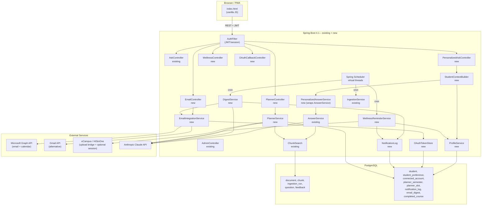
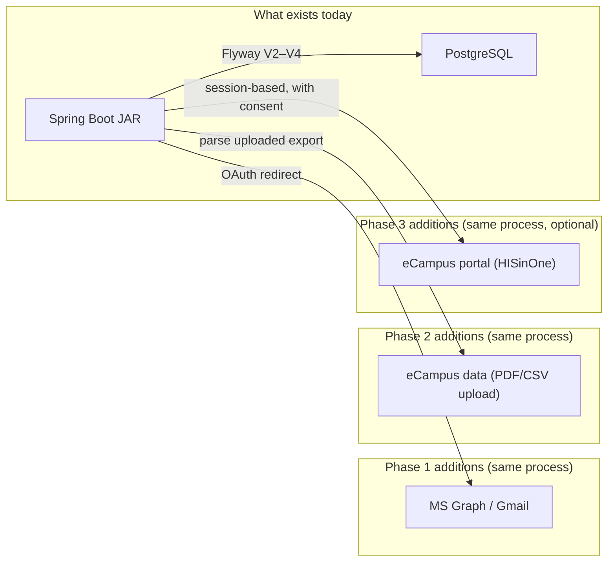
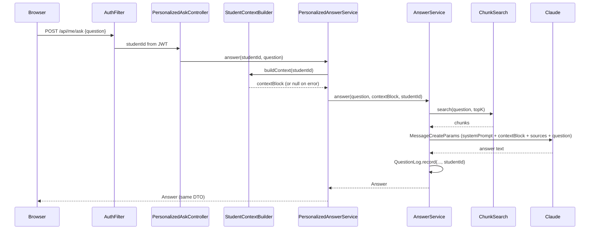
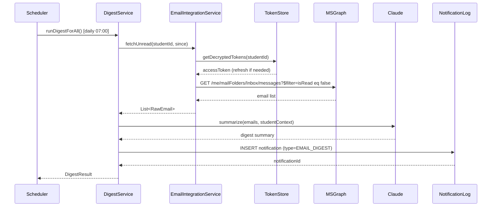
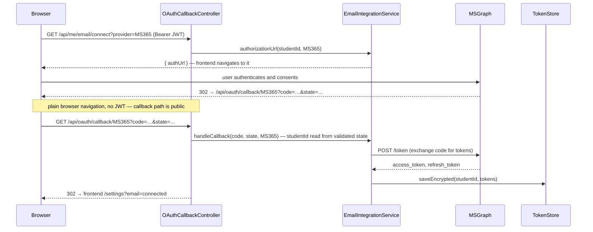
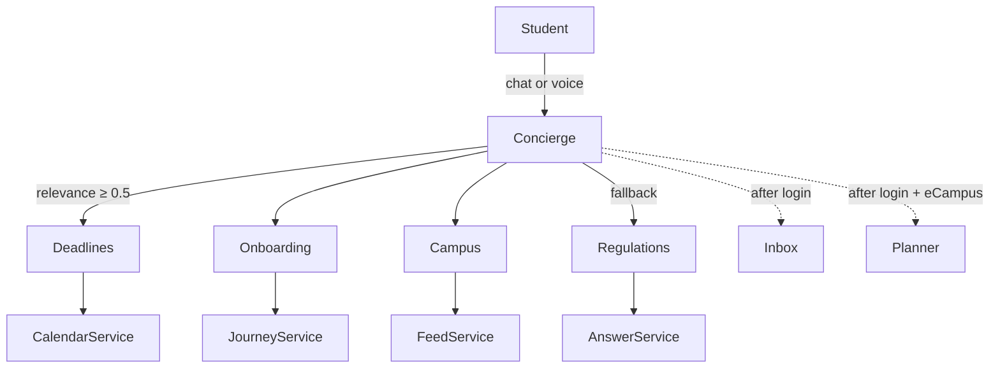

# Design Document: Personalized University Student Assistant

## Overview

The Personalized University Assistant extends the existing university study assistant from a
stateless Q&A bot into a long-lived, identity-aware companion. It adds a user profile layer on top
of the existing RAG pipeline, then progressively connects external university and personal services:
email (Microsoft 365 / Google Workspace), a configurable course portal (defaulting to HISinOne), a
semester planner, and a proactive wellness/lifestyle reminder engine.

While the initial deployment targets Uni Kassel, all university-specific values (name, portal URL,
SSO mechanism, email domain pattern, crawler sitemaps) are driven by YAML configuration. Swapping
in a second institution requires only a new configuration profile — no code changes.

The design is organized into three incremental phases:

- **Phase 1 (Vertical Slice)** — User authentication, profile, personalized Q&A, and email digest.
  Delivers a working end-to-end experience with the lowest risk.
- **Phase 2 (Course Tools)** — Semester course planner backed by the existing RAG module index,
  plus an **eCampus data bridge**: students upload or paste exported data (grade transcripts,
  enrolled courses, upcoming exam dates) from eCampus / HISinOne, which the assistant parses
  and stores — no credentials or scraping required.
- **Phase 3 (Action & Wellness)** — Proactive eCampus deadline alerts, health & wellness nudges,
  campus event suggestions, and (if an official API or explicit SSO consent becomes available)
  assisted course/exam registration directly through eCampus.

Every new service follows the existing code conventions: Spring-managed beans, `JdbcClient` for
database access, `AssistantProperties` for configuration, and the `llm.LlmClient` interface for AI
synthesis. "Claude" in this document means whichever model `LlmClient` is configured with: a free
local model through Ollama during development, Claude once the project is approved
(`docs/decisions.md` #11). New services never call the Anthropic SDK directly.
University-specific behaviour (portal type, allowed email domains, grade scale) is injected via
`UniversityProperties` — a new configuration record extending `AssistantProperties`.

---

## Architecture

### High-Level System Diagram



### Deployment Topology



No new runtime processes are required through Phase 2. Everything runs inside the existing Spring
Boot JAR. A Redis or message-queue tier is deferred until user load justifies it.

Phase 2 eCampus data ingestion is **push-based**: the student exports data from eCampus
(grade transcript PDF, enrollment list, exam schedule) and uploads it via the assistant's UI.
No outbound connection to eCampus is made. Phase 3 optionally adds a session-based client if
the university enables an official API or the student explicitly grants SSO consent.

---

## Components and Interfaces

### Component: ProfileService

**Purpose**: Owns the student identity and preference model. Provides the student context that
every personalized service reads.

**Interface** (Java):
```java
public interface ProfileService {
    /** Creates or updates the profile for an authenticated student. */
    StudentProfile upsert(StudentProfile profile);

    /** Loads profile by internal ID; throws if not found. */
    StudentProfile get(long studentId);

    /** Returns all preferences for a student, keyed by preference name. */
    Map<String, String> preferences(long studentId);

    /** Upserts a single named preference value. */
    void setPreference(long studentId, String name, String value);
}
```

**Responsibilities**:
- Create/update the `student` row on first login (after JWT is validated).
- Read/write `student_preference` key-value pairs.
- Provide a `StudentContextSnapshot` consumed by `StudentContextBuilder`.

---

### Component: StudentContextBuilder

**Purpose**: Assembles all relevant student data — preferences, enrolled courses, recent digest
summaries, upcoming deadlines — into a compact context string to be prepended to Claude prompts.

**Interface**:
```java
public interface StudentContextBuilder {
    /**
     * Returns a prompt-ready context block for the given student.
     * Safe to call on every request; results may be cached for up to 5 minutes.
     */
    String buildContext(long studentId);
}
```

**Responsibilities**:
- Pull preferences, planner state, recent notifications, and academic calendar dates.
- Render a structured XML-wrapped block (mirrors the `<sources>` pattern in `AnswerService`).
- Stay within a token budget (≤ 2 000 tokens by default, configurable).

---

### Component: PersonalizedAnswerService

**Purpose**: Thin wrapper around the existing `AnswerService` that injects student context into
the system prompt before calling Claude.

**Interface**:
```java
public interface PersonalizedAnswerService {
    AnswerService.Answer answer(long studentId, String question);
}
```

**Required change to the existing `AnswerService`** (done before any personalization work):
`AnswerService.answer(String)` today uses a fixed `SYSTEM_PROMPT` and writes the question log
itself. It gains one overload, and the old method delegates to it:

```java
public Answer answer(String question) { return answer(question, null, null); }

/**
 * @param studentContext rendered <student-context> block, or null for anonymous use
 * @param studentId      written to question.student_id, or null for anonymous use
 */
public Answer answer(String question, String studentContext, Long studentId);
```

When `studentContext` is non-null it is placed before `<sources>` in the user message and the
personalization sentence is appended to the system prompt. The question is still logged exactly
once, inside `AnswerService`, so `PersonalizedAnswerService` does not log anything itself.
`ChunkSearch`, `ChunkSearch.search()` and `ChunkSearch.RetrievedChunk` become `public` so that
`PlannerService` and `WellnessReminderService` (other packages) can use retrieval.

**Responsibilities**:
- Call `StudentContextBuilder.buildContext(studentId)`; on failure, log WARN and pass `null`.
- Delegate retrieval, answer generation and question logging to `AnswerService`.

---

### Component: EmailIntegrationService

**Purpose**: Manages the OAuth 2.0 token lifecycle and provides a uniform interface to fetch
unread emails regardless of whether the provider is Microsoft or Google.

**Interface**:
```java
public interface EmailIntegrationService {
    /** Returns the authorization URL to send the student to. */
    String authorizationUrl(long studentId, EmailProvider provider);

    /**
     * Validates the signed state, takes the studentId from it, exchanges the authorization code
     * for tokens and persists them. Called from a public endpoint, so it never trusts anything
     * but the state for identity.
     */
    void handleCallback(String code, String state, EmailProvider provider);

    /** Fetches unread emails since the given instant. Never returns null; may return empty list. */
    List<RawEmail> fetchUnread(long studentId, Instant since);

    /** Returns the connected provider for a student, or empty. */
    Optional<EmailProvider> connectedProvider(long studentId);

    enum EmailProvider { MS365, GMAIL }
}
```

**Responsibilities**:
- Store and refresh OAuth tokens in `connected_account` using AES-256-GCM encryption at rest.
- Call Microsoft Graph `/me/mailFolders/Inbox/messages` or Gmail `users.messages.list`.
- Handle token expiry transparently via the refresh token.
- Never log or return raw credentials.

---

### Component: DigestService

**Purpose**: Periodically fetches new emails, summarises them with Claude, and stores the digest
as a notification for the student to read.

**Interface**:
```java
public interface DigestService {
    /** Runs digest generation for all students with connected email accounts. */
    void runDigestForAll();

    /** Runs digest for one student (also callable on demand). */
    DigestResult runDigest(long studentId);

    record DigestResult(long notificationId, String summary, int emailCount) {}
}
```

**Responsibilities**:
- Scheduled daily (configurable cron, default 07:00).
- Summarise batches of up to 20 emails per Claude call with an instruction to flag deadlines,
  registration windows, and urgent items.
- Persist the resulting summary in `notification_log` with type `EMAIL_DIGEST`.
- Respect rate limits: skip students whose last digest ran within the last 4 hours.

---

### Component: PlannerService

**Purpose**: Manages the student's semester-by-semester course plan and answers planner queries
using RAG module data.

**Interface**:
```java
public interface PlannerService {
    /** Returns all planner semesters for a student. */
    List<PlannerSemester> getplan(long studentId);

    /** Adds or replaces a course slot in a semester. */
    PlannerSlot upsertSlot(long studentId, PlannerSlotDraft draft);

    /** Removes a slot. */
    void removeSlot(long studentId, long slotId);

    /** AI-assisted suggestion: returns a list of recommended next courses. */
    List<CourseSuggestion> suggestNext(long studentId);

    /** Records that the student completed a course with the given grade. */
    void markCompleted(long studentId, String moduleCode, BigDecimal grade);
}
```

**Responsibilities**:
- Persist plan state in `planner_semester` and `planner_slot`.
- Call `ChunkSearch` to ground suggestions in module catalog data from the RAG index.
- Track completed modules in `completed_course` for prerequisite checking.

---

### Component: WellnessReminderService

**Purpose**: Generates and dispatches proactive health and lifestyle nudges tailored to the
student's schedule and recent activity.

**Interface**:
```java
public interface WellnessReminderService {
    /**
     * Evaluates all students and enqueues reminders for those who are due one.
     * Called by the scheduler every 30 minutes.
     */
    void evaluateAll();

    /** Returns recent notifications for the student (all types, newest first). */
    List<NotificationEntry> recentNotifications(long studentId, int limit);
}
```

**Responsibilities**:
- Apply configurable rules (e.g. "no break reminder within the last 2 hours") before generating.
- Use Claude to personalize the nudge text based on the student's name and time of day.
- Store each nudge in `notification_log` with type `WELLNESS` or `EVENT`.
- Support push delivery via Web Push (Phase 3) or in-app polling (Phase 1–2).

---

## Data Models

### New Schema (Flyway V2–V5)

Migrations are ordered so that each phase only depends on tables created in the same or an
earlier phase. The V-numbers below are working names: Flyway rejects a lower version added
after a higher one has been applied, and the email work (connected accounts) waits for ITS
approval, so each migration file takes the **next free version number when its task is
implemented**. Expected order: student profile → notifications → course planner → connected
accounts (whenever email is approved).

#### V2: Student, Preferences, and Question Link

```sql
-- V2__student_profile.sql
CREATE TABLE student (
    id             BIGSERIAL    PRIMARY KEY,
    email          TEXT         NOT NULL UNIQUE,      -- stored lower-case
    password_hash  TEXT         NOT NULL,             -- bcrypt, cost 12
    email_verified_at TIMESTAMPTZ,                    -- NULL until the verification link is opened
    display_name   TEXT         NOT NULL DEFAULT '',
    degree_program TEXT         NOT NULL DEFAULT '',   -- e.g. 'Informatik M.Sc.'
    enrollment_year INT,
    target_semester INT,                                -- planned graduation semester count
    created_at     TIMESTAMPTZ  NOT NULL DEFAULT now(),
    last_seen_at   TIMESTAMPTZ  NOT NULL DEFAULT now()
);
-- (the UNIQUE constraint on email already creates an index)

-- Single-use email verification tokens; only the SHA-256 of the token is stored.
CREATE TABLE email_verification (
    token_hash  TEXT        PRIMARY KEY,
    student_id  BIGINT      NOT NULL REFERENCES student (id) ON DELETE CASCADE,
    expires_at  TIMESTAMPTZ NOT NULL
);

-- Personalized questions are linked to the student; anonymous rows stay NULL.
ALTER TABLE question ADD COLUMN student_id BIGINT REFERENCES student (id) ON DELETE SET NULL;
CREATE INDEX question_student_idx ON question (student_id) WHERE student_id IS NOT NULL;

-- Flexible key-value preferences (language, notification times, wellness opt-in, etc.)
CREATE TABLE student_preference (
    id          BIGSERIAL   PRIMARY KEY,
    student_id  BIGINT      NOT NULL REFERENCES student (id) ON DELETE CASCADE,
    name        TEXT        NOT NULL,   -- e.g. 'language', 'wellness_enabled', 'digest_time'
    value       TEXT        NOT NULL,
    updated_at  TIMESTAMPTZ NOT NULL DEFAULT now(),
    UNIQUE (student_id, name)
);
CREATE INDEX student_pref_student_idx ON student_preference (student_id);
```

#### V3: Connected Accounts (OAuth tokens)

```sql
-- V3__connected_accounts.sql
CREATE TABLE connected_account (
    id              BIGSERIAL   PRIMARY KEY,
    student_id      BIGINT      NOT NULL REFERENCES student (id) ON DELETE CASCADE,
    provider        TEXT        NOT NULL,   -- 'MS365' | 'GMAIL'
    provider_email  TEXT,
    -- AES-256-GCM encrypted JSON blob; key stored in environment variable ACCOUNT_ENCRYPTION_KEY
    token_ciphertext BYTEA      NOT NULL,
    token_iv         BYTEA      NOT NULL,
    token_tag        BYTEA      NOT NULL,
    scope            TEXT       NOT NULL DEFAULT '',
    expires_at       TIMESTAMPTZ,
    connected_at     TIMESTAMPTZ NOT NULL DEFAULT now(),
    last_used_at     TIMESTAMPTZ,
    UNIQUE (student_id, provider)
);
```

#### V4: Notifications and Email Digests

```sql
-- V4__notifications.sql
CREATE TABLE notification_log (
    id          BIGSERIAL   PRIMARY KEY,
    student_id  BIGINT      NOT NULL REFERENCES student (id) ON DELETE CASCADE,
    type        TEXT        NOT NULL,   -- 'EMAIL_DIGEST' | 'WELLNESS' | 'EVENT' | 'DEADLINE'
    title       TEXT        NOT NULL DEFAULT '',
    body        TEXT        NOT NULL,
    read        BOOLEAN     NOT NULL DEFAULT false,
    created_at  TIMESTAMPTZ NOT NULL DEFAULT now()
);
CREATE INDEX notif_student_created_idx ON notification_log (student_id, created_at DESC);

CREATE TABLE email_digest (
    id                BIGSERIAL   PRIMARY KEY,
    notification_id   BIGINT      NOT NULL REFERENCES notification_log (id) ON DELETE CASCADE,
    email_count       INT         NOT NULL,
    earliest_email_at TIMESTAMPTZ,
    latest_email_at   TIMESTAMPTZ,
    raw_subjects      TEXT[]      NOT NULL DEFAULT '{}'
);
```

#### V5: Course Planner

```sql
-- V5__course_planner.sql
CREATE TABLE planner_semester (
    id          BIGSERIAL   PRIMARY KEY,
    student_id  BIGINT      NOT NULL REFERENCES student (id) ON DELETE CASCADE,
    label       TEXT        NOT NULL,   -- e.g. 'WS 2025/26'
    ordinal     INT         NOT NULL,   -- 1 = first semester, 2 = second, ...
    UNIQUE (student_id, ordinal)
);

CREATE TABLE planner_slot (
    id                  BIGSERIAL   PRIMARY KEY,
    planner_semester_id BIGINT      NOT NULL REFERENCES planner_semester (id) ON DELETE CASCADE,
    module_code         TEXT        NOT NULL,
    module_title        TEXT        NOT NULL DEFAULT '',
    ects                INT,
    status              TEXT        NOT NULL DEFAULT 'planned',  -- 'planned' | 'enrolled' | 'completed' | 'failed' | 'dropped'
    notes               TEXT        NOT NULL DEFAULT ''
);
CREATE INDEX planner_slot_semester_idx ON planner_slot (planner_semester_id);

CREATE TABLE completed_course (
    id          BIGSERIAL   PRIMARY KEY,
    student_id  BIGINT      NOT NULL REFERENCES student (id) ON DELETE CASCADE,
    module_code TEXT        NOT NULL,
    module_title TEXT       NOT NULL DEFAULT '',
    ects        INT,
    grade       NUMERIC(3,1),           -- configurable scale (e.g. 1.0–5.0 German or 0–100); NULL = pass/fail
    passed      BOOLEAN     NOT NULL DEFAULT true,
    semester    TEXT,
    UNIQUE (student_id, module_code)
);
```

The `question.student_id` column is added in V2 (Phase 1), not here.

---

## API Endpoint Definitions

### Authentication

```
POST /api/auth/register
  Body: { "email": "s123456@student.example.edu"  // any university email, "password": "…", "displayName": "…" }
  Response 201: { "token": "<JWT>", "studentId": 42 }

POST /api/auth/login
  Body: { "email": "…", "password": "…" }
  Response 200: { "token": "<JWT>", "studentId": 42 }
```

JWT is RS256-signed; secret key loaded from `JWT_PRIVATE_KEY_PATH` environment variable.
Tokens expire after 24 hours; a refresh endpoint issues a new token against the old one within a
7-day window.

```
GET /api/auth/verify?token=…
  Response 302 → frontend with ?verified=1 (or ?verified=0 if the token is unknown or expired)
```

Registration creates an unverified account and sends a verification link; login returns
`403 email_not_verified` until it is opened. Without this check anyone could register with
another student's address. In the `dev` profile the link is logged instead of emailed, so local
development needs no SMTP server.

### Security Filter Chain

Adding `spring-boot-starter-security` locks every endpoint by default, so an explicit
`SecurityFilterChain` bean is part of Phase 1:

| Path | Access |
|------|--------|
| `/`, `/index.html`, static resources, `/actuator/health` | public |
| `POST /api/ask`, `POST /api/questions/*/feedback` | public (existing anonymous use) |
| `/api/auth/**` | public |
| `GET /api/oauth/callback/*` | public — browser redirect from the provider; identity comes from the signed `state` |
| `/api/admin/**` | public at the filter level; `AdminController` keeps its own `X-Admin-Token` check |
| `/api/me/**` | JWT required (`AuthFilter`) |
| anything else | denied |

Sessions are stateless (`SessionCreationPolicy.STATELESS`), CSRF protection is disabled because
no cookies are used for authentication, and the default form login / HTTP Basic are turned off.

```
POST /api/auth/refresh
  Header: Authorization: Bearer <expiring-token>
  Response 200: { "token": "<new-JWT>" }
```

### Profile

```
GET  /api/me                         → StudentProfileDto
PUT  /api/me                         Body: StudentProfileDto  → 204
GET  /api/me/preferences             → Map<String, String>
PUT  /api/me/preferences/{name}      Body: { "value": "…" }  → 204
GET  /api/me/notifications?limit=20  → List<NotificationDto>
POST /api/me/notifications/{id}/read → 204
```

### Personalized Q&A

```
POST /api/ask
  Existing endpoint — unchanged for anonymous use.

POST /api/me/ask
  Body: { "question": "…" }  (max 1 000 chars, same as /api/ask)
  Response: same Answer shape as /api/ask, but Claude receives student context
```

### Email Integration

```
GET  /api/me/email/connect?provider=MS365      → { "authUrl": "https://login.microsoftonline.com/…" }
GET  /api/oauth/callback/{provider}            → 302 redirect to frontend with result
DELETE /api/me/email                           → 204 (revoke and delete tokens)
GET  /api/me/email/status                      → { "connected": true, "provider": "MS365", "providerEmail": "…" }
POST /api/me/email/digest                      → 202 (trigger digest on demand)
GET  /api/me/email/digests?limit=10            → List<DigestSummaryDto>
```

### Course Planner

```
GET    /api/me/planner                          → List<PlannerSemesterDto>
POST   /api/me/planner/semesters                Body: { "label": "WS 2025/26", "ordinal": 3 }  → 201
POST   /api/me/planner/semesters/{sid}/slots    Body: PlannerSlotDraftDto                       → 201
PUT    /api/me/planner/slots/{id}               Body: PlannerSlotDraftDto                       → 204
DELETE /api/me/planner/slots/{id}               → 204
POST   /api/me/planner/completed                Body: CompletedCourseDto                        → 201
GET    /api/me/planner/suggestions              → List<CourseSuggestionDto>
```

### Wellness

```
GET  /api/me/wellness/notifications?limit=10    → List<NotificationDto>
PUT  /api/me/wellness/settings                  Body: { "enabled": true, "quietHoursStart": "22:00", "quietHoursEnd": "08:00" }
```

### eCampus Data Bridge

```
POST /api/me/ecampus/upload
  Multipart: file (PDF transcript or CSV enrollment export, max 5 MB)
  Response 200: { "imported": { "completedCourses": 12, "enrolledCourses": 3,
                                  "examDates": 5, "warnings": [] } }
  Response 422: { "error": "unparseable_file", "detail": "…" }

GET /api/me/ecampus/imports?limit=5
  Response: List of past upload summaries (timestamp, counts, any warnings)
```

### Admin (existing, unchanged)

```
POST /api/admin/ingest   Header: X-Admin-Token
```

---

## Personalization Strategy

### Context Injection into Claude Prompts

Every call to `PersonalizedAnswerService` prepends a `<student-context>` XML block to the existing
system prompt. The block is assembled by `StudentContextBuilder` from:

1. **Profile facts** — name, degree program, enrollment year, target semesters.
2. **Preferences** — language preference, degree track, thesis topic if set.
3. **Academic snapshot** *(Phase 2, once V5 exists)* — completed modules, current semester label,
   total ECTS earned.
4. **Active planner** *(Phase 2)* — courses planned for the current and next semester.
5. **Recent deadlines** — any `DEADLINE` notifications created in the last 14 days.

In Phase 1 the builder renders only sections 1, 2 and 5; Phase 2 adds 3 and 4.

Example rendered block (kept under 2 000 tokens):

```xml
<student-context>
  <profile name="Alice M." program="{degree_program}" semester="3" ects-earned="60"/>
  <completed-modules>
    <module code="CS-301" title="Algorithms and Data Structures" ects="9"/>
    <module code="CS-401" title="Machine Learning" ects="9"/>
  </completed-modules>
  <current-plan semester="{current_term}">
    <slot code="CS-501" title="Distributed Systems" status="enrolled"/>
    <slot code="CS-502" title="Computer Vision" status="planned"/>
  </current-plan>
  <preferences language="de" wellness="true"/>
</student-context>
```

The existing system prompt is extended with one additional sentence:

> "You also have access to the student's personal academic context in the `<student-context>` block
> above. Use it to tailor your answer (e.g. refer to courses they've completed or are planning)."

### Context Token Budget Enforcement

`StudentContextBuilder` renders the context and measures its approximate token count (1 token ≈
4 chars). If it exceeds `assistant.personalization.context-max-tokens` (default 2 000), content is
dropped in this order until it fits: (1) completed modules older than 2 years, (2) preferences,
(3) plan slots. `DEADLINE` notifications and profile facts are never dropped; if they alone
exceed the budget, the oldest deadlines are truncated last (Requirement 3.4).

---

## Main Algorithm / Workflow Diagrams

### Personalized Q&A Flow



### Email Digest Flow



### OAuth Connection Flow



---

## Email Integration Design

### OAuth 2.0 Flow

| Step | Detail |
|------|--------|
| Provider registration | App registered in Azure AD (MS365) and Google Cloud Console (Gmail). Redirect URI: `https://<host>/api/oauth/callback/{provider}`. Scopes: `Mail.Read` (MS) / `https://www.googleapis.com/auth/gmail.readonly` (Google). |
| State parameter | A short-lived (10 min), HMAC-signed token encoding `studentId` and a nonce. Validated on callback to prevent CSRF. |
| Token storage | `access_token` + `refresh_token` encrypted with AES-256-GCM before writing to `connected_account.token_ciphertext`. Key is loaded from `ACCOUNT_ENCRYPTION_KEY` env var (must never be committed). |
| Token refresh | `EmailIntegrationService` transparently refreshes before every API call when `expires_at - 5 min ≤ now()`. |
| Revocation | `DELETE /api/me/email` calls the provider's revoke endpoint and deletes the row from `connected_account`. |

### Email Polling

- **Polling interval**: daily scheduled digest. On-demand available via `POST /api/me/email/digest`.
- **Delta tracking**: `last_email_at` stored in `email_digest` tells the next fetch how far back to look.
- **MS Graph filter**: `$filter=receivedDateTime ge {iso8601} and isRead eq false`, sorted desc, top 50.
- **Gmail**: `q=is:unread after:{epoch}`, up to 50 messages, fetching headers + snippet only.

### Email Summarisation Pipeline

```
RawEmail[] (subject, sender, snippet, date)
    ↓ truncate/sanitize (no HTML, max 300 chars per body snippet)
    ↓ batch into groups of ≤ 20
    ↓ ClaudeDigestPrompt (one call per batch):
       "You are summarizing university emails for a student.
        Identify: (1) urgent deadlines, (2) registration windows,
        (3) important admin notices, (4) everything else.
        Output: structured markdown digest. Flag anything requiring action."
    ↓ concatenate batch summaries (one "### Part n" heading per batch) into one digest
    ↓ one NotificationLog entry (type = EMAIL_DIGEST) + one email_digest row per run
```

**Before building this:** the university's Microsoft 365 tenant most likely requires an
administrator to consent to a third-party app requesting `Mail.Read`, and forwarding students'
email content to Claude needs a data-protection review. Both must be cleared with ITS first
(see `docs/decisions.md` #9). Gmail is deferred.

**Security note**: Email body content is user data, not instructions. It is wrapped in
`<email>` tags and the system prompt explicitly states it must be treated as data only (mirrors
the existing `<source>` treatment in `AnswerService`).

---

## Course Registration Integration Design

### eCampus Integration Strategy

Uni Kassel's **eCampus** is the student-facing brand of their HISinOne campus management system.
It handles exam registration/deregistration, course enrollment, grade records (HISPOS), semester
re-registration (Rückmeldung) status, and certificate downloads.

HISinOne does **not** publish a public REST API for third-party integrations. As a student
(non-admin) accessing the portal, the realistic integration approaches are:

| Approach | Phase | Risk | Notes |
|----------|-------|------|-------|
| **Upload bridge** — student exports data from eCampus (PDF transcript, CSV schedule) and uploads to the assistant | Phase 2 | Low | No credentials stored, no scraping, no ToS risk |
| **Session-based client** — student consents to SSO delegation; assistant acts on their behalf | Phase 3 | Medium | Requires explicit consent UI + university cooperation |
| **Official API** — university opens a REST endpoint | Phase 3+ | Low once available | Deferred |

**Phase 2 — Upload Bridge**: Students export their data from eCampus and upload it:
- Grade transcript → PDF, parsed with PDFBox (already a dependency)
- Enrolled courses / exam schedule → manually copied text or exported CSV
- The `ECampusDataParser` service extracts structured records and stores them in the planner tables
- No outbound connection to eCampus; no credentials; no ToS exposure

**Phase 3 — Session Client (not planned)**: Acting inside eCampus on the student's behalf goes
against `docs/decisions.md` #3 and is not built unless the university provides an official API or
written approval. The description below is kept only as a sketch for that case. If/when conditions allow, an
`ECampusSessionClient` implementation of `CoursePortalClient` handles SSO-delegated requests.
The user explicitly confirms every action in the UI ("You are about to register for: {module_title}
{term}. Proceed?") before any request is sent. Session tokens are never persisted.

### CoursePortalClient Interface

Used in Phase 3 when session-based or API access is available. Phase 2 uses the upload bridge
instead — `CoursePortalClient` is not called in Phase 2.

```java
/**
 * Abstraction over the university's course-registration portal.
 * Phase 2 implementation: ECampusUploadBridge (parses student-uploaded exports)
 * Phase 3 implementation: ECampusSessionClient (SSO-delegated session, consent-gated)
 * Swappable via the {@code assistant.university.portal-type} config key.
 */
public interface CoursePortalClient {
    /** Returns currently available registration windows for the student. */
    List<RegistrationWindow> availableRegistrations(long studentId);

    /**
     * Registers for a course. The studentId must match the session owner.
     * Returns a RegistrationResult with status and any confirmation text from the portal.
     * REQUIRES explicit user confirmation before calling.
     */
    RegistrationResult register(long studentId, String moduleCode, String termKey);

    /** Returns the student's current exam registrations. */
    List<ExamRegistration> examRegistrations(long studentId);
}
```

**Session management**: Never store the student's portal password. The Phase 3
`ECampusSessionClient` uses the university's SSO (Shibboleth / SAML / OpenID Connect —
configurable via `assistant.university.sso-type`) to obtain a session token valid only for the
duration of the action; it is never persisted. The Phase 2 upload bridge requires no credentials
at all.

---

### Component: ECampusDataParser

**Purpose**: Parses student-uploaded eCampus exports (PDF transcripts, plain-text enrollment
lists) and writes structured records into the planner and profile tables.

**Interface**:
```java
public interface ECampusDataParser {
    /**
     * Parses an uploaded grade transcript PDF and returns extracted course records.
     * Uses PDFBox (already in pom.xml) for text extraction.
     */
    ParseResult parseTranscript(InputStream pdfStream);

    /**
     * Parses a plain-text or CSV enrollment / exam-schedule export.
     * Accepts tab-separated or semicolon-separated formats.
     */
    ParseResult parseEnrollmentExport(InputStream textStream, String mimeType);

    record ParseResult(
        List<CompletedCourseRecord> completedCourses,
        List<EnrolledCourseRecord> enrolledCourses,
        List<ExamDateRecord> upcomingExams,
        List<String> warnings   // unparsed lines, format mismatches
    ) {}
}
```

**Responsibilities**:
- Extract module codes, titles, ECTS, grades, and semester labels from PDF text blocks.
- Extract enrolled course names, times, and exam dates from enrollment exports.
- Store results via `PlannerService` (completed courses → `completed_course` table,
  enrollments → `planner_slot` with status `enrolled`).
- Store upcoming exam dates as `DEADLINE` notifications in `notification_log`.
- Return warnings for any rows that could not be parsed, so the student can review them.
- Never expose raw file bytes beyond the parse step; discard the upload after processing.

---

## Course Planner Data Model (detailed)

### Degree Requirements

Degree requirements (e.g. "30 ECTS from the core area") are not yet available as structured data
from the university. In Phase 2, completed-course data comes from two sources:
1. **eCampus upload** — `ECampusDataParser` extracts grades and ECTS from the student's uploaded
   transcript PDF, populating `completed_course` automatically.
2. **Manual entry** — the student can also add or correct courses directly in the UI.

`PlannerService.suggestNext()` calls `ChunkSearch` with a query derived from the student's degree
program and passes the results plus completed modules to Claude to recommend what to take next.
This leverages the existing RAG index rather than requiring a hand-curated requirements tree.

In Phase 3, if a structured examination-regulation document (e.g. a Prüfungsordnung or equivalent)
becomes available as machine-readable data, it can be stored in a `degree_requirement` table and
referenced by `PlannerService`. The table design is university-agnostic.

### Planner State Machine

```
planned → enrolled → completed
                   → failed → (re-plan)
planned → dropped
```

Status transitions are validated in `PlannerService` before writing to the database.

---

## Health / Wellness Reminder Engine

### Rule Engine

Before calling Claude, a lightweight rule layer decides whether a reminder is appropriate:

```java
interface WellnessRule {
    /**
     * Returns true if this rule allows sending a reminder right now for this student.
     * All rules must pass (AND logic).
     */
    boolean allows(long studentId, WellnessContext ctx);
}
```

Built-in rules:
1. `QuietHoursRule` — blocks reminders inside the student's quiet-hours window
   (`quietHoursStart` inclusive to `quietHoursEnd` exclusive, in the university time zone). A
   window whose end is earlier than its start crosses midnight, e.g. 22:00–08:00.
2. `CooldownRule` — blocks if a reminder of the same type was sent within the effective cooldown.
3. `OptInRule` — blocks unless the `wellness_enabled` preference is `true`.
4. `ExamPeriodRule` — never blocks by itself; if a `DEADLINE` notification falls within the next
   72 hours it doubles the effective cooldown that `CooldownRule` applies.

Only successfully generated nudges are written to `notification_log`; a failed Claude call is
logged at WARN and nothing is stored (Requirement 10.4, 10.5).

### AI-Generated Nudge Text

When all rules pass, `WellnessReminderService` calls Claude with a minimal prompt:

```
System: "You are a friendly wellness assistant for a university student.
         Generate one short (≤ 40 words), warm, motivating reminder of type {type}.
         Time of day: {timeOfDay}. Student name: {name}.
         Types: HYDRATE | BREAK | EXERCISE | EAT | SLEEP."
User: "Generate reminder."
```

The student name is included for warmth; no other personal data is sent in this call.

### Campus Event Suggestions

Events are pulled from the RAG-indexed university pages (student services, student union, and
department pages — whichever are included in `assistant.crawler.include-prefixes`).
`WellnessReminderService` issues a `ChunkSearch` for "event OR Veranstaltung" once per day and
passes the top-5 results to Claude for a brief summary tailored to the student's degree program.
The search query terms are configurable via `assistant.university.event-search-terms`.

---

## Notification / Reminder Scheduling

Spring `@Scheduled` with virtual threads (already enabled via `spring.threads.virtual.enabled: true`):

```java
@Scheduled(cron = "${assistant.digest.cron:0 0 7 * * *}")      // daily 07:00
void runDigests() { digestService.runDigestForAll(); }

@Scheduled(fixedDelay = 1_800_000)                              // every 30 min
void runWellness() { wellnessReminderService.evaluateAll(); }

@Scheduled(cron = "${assistant.crawler.cron}")                  // existing
void runIngestion() { ingestionService.startInBackground(); }
```

Notifications are stored in `notification_log` and polled by the frontend (`GET /api/me/notifications`).
Web Push (VAPID) is a Phase 3 addition; Phase 1–2 use client-side polling every 60 seconds.

---

## Security Considerations

| Concern | Mitigation |
|---------|------------|
| Student credential storage | Never stored. Passwords are bcrypt-hashed (cost 12). OAuth tokens are AES-256-GCM encrypted at rest. |
| JWT secrets | RS256 private key loaded from `JWT_PRIVATE_KEY_PATH`; public key for verification only in app config. |
| OAuth state parameter | HMAC-SHA256 signed with a server secret; 10-minute TTL; validated on callback. |
| Email content in prompts | Wrapped in `<email>` tags with system-prompt instruction to treat as data (same as `<source>` in AnswerService). |
| eCampus upload safety | Uploaded files are parsed in memory and discarded immediately; raw bytes are never stored or forwarded. File size capped at 5 MB. |
| Course action confirmation | Every mutating eCampus action (Phase 3) requires explicit user confirmation before execution. |
| Token encryption key | `ACCOUNT_ENCRYPTION_KEY` never committed; rotated by re-encrypting all rows on key change. |
| Anonymous question log | Existing behavior preserved. Personalized questions link to `student_id`. A daily job deletes all `question` rows older than 12 months (Requirement 13.8). |
| Account takeover by address | Registration requires opening a verification link sent to the university address before login works. |
| Public endpoints after adding Spring Security | Explicit `SecurityFilterChain` (see "Security Filter Chain") keeps the anonymous Q&A, static UI and admin endpoint working. |
| Admin token | Existing constant-time comparison preserved. |

---

## Testing Strategy

### Unit Testing Approach

Follow the existing pattern (`ChunkerTests`, `ContentExtractorTests`): plain JUnit 5 tests with
no application context for pure logic (budget trimming, rule chains, state machine, encryption,
parsers). Services whose logic is mostly SQL are tested against a real PostgreSQL via
Testcontainers instead of a mocked `JdbcClient`, whose fluent API is awkward to mock and would
not catch SQL mistakes. Testcontainers needs a local Docker runtime. Claude is always mocked.
Tests live in `src/test/java/.../` mirroring the source package structure.

Key unit test targets:
- `StudentContextBuilder` — verify token budget enforcement and section drop order.
- `WellnessReminderService` — verify rule engine combinations (quiet hours, cooldown, opt-in).
- `EmailIntegrationService` — verify token refresh logic and encryption round-trip.
- `PlannerService` — verify status-transition validation.

### Property-Based Testing (PBT)

**Library**: [jqwik](https://jqwik.net/) (JUnit 5 extension, `net.jqwik:jqwik:1.9.2`)

#### P1: Chunker size invariant (existing, extend)

```
∀ sections : List<Section>
  ∀ chunk ∈ Chunker.chunk(sections)
    chunk.text().length() ≤ MAX_CHARS
```

#### P2: Student context token budget

```
∀ studentId, profile, preferences, plan
  StudentContextBuilder.buildContext(studentId).length()
    ≤ contextMaxTokens * 4   // chars ≈ 4 × tokens
```

#### P3: Notification cooldown invariant

```
∀ studentId, type, now
  lastNotification(studentId, type).createdAt + cooldown > now
    ⟹ WellnessRule.allows(studentId) = false
```

#### P4: OAuth state validation

```
∀ studentId ∈ valid IDs, nonce ∈ random bytes
  let state = sign(studentId, nonce, now)
  validate(state, now + 9 min) = true
  validate(state, now + 11 min) = false   // expired
  validate(tampered(state), now) = false  // invalid signature
```

#### P5: Planner status transition validity

```
∀ slot : PlannerSlot, transition : (Status → Status)
  transition ∉ VALID_TRANSITIONS(slot.status)
    ⟹ PlannerService.upsertSlot(...) throws IllegalStateException
```

#### P6: Email batch size

```
∀ emails : List<RawEmail> where emails.size() > 0
  DigestService partitions emails into batches
  ∀ batch ∈ batches: batch.size() ≤ 20
```

### Integration Testing Approach

Spring Boot test slices (`@WebMvcTest`, `@JdbcTest`) with embedded PostgreSQL (Testcontainers).
A `MockMvc` test suite covers all new REST endpoints for status codes and response shapes.

---

## Performance Considerations

- **Context caching**: `StudentContextBuilder` caches the rendered context string in memory for
  5 minutes per student (Caffeine `LoadingCache`) to avoid repeated DB reads on every question.
- **Claude call batching**: The digest summarizer batches up to 20 emails per Claude call to keep
  call count proportional to student count, not email count.
- **Virtual threads**: All HTTP handlers and scheduler tasks run on virtual threads (already
  enabled), so long-running Claude or Graph API calls do not block platform threads.
- **Pagination**: All `GET` endpoints returning lists accept `?limit` and `?offset` parameters
  (max 100 per page).

---

## Dependencies

New dependencies to add to `pom.xml`:

| Artifact | Version | Purpose |
|----------|---------|---------|
| `com.nimbusds:nimbus-jose-jwt` | `9.47` | JWT creation and verification (RS256) |
| `net.jqwik:jqwik` | `1.9.2` | Property-based testing |
| `com.github.ben-manes.caffeine:caffeine` | `3.2.0` | In-memory context cache |
| `org.springframework.boot:spring-boot-starter-security` | managed | HTTP security filter chain |
| `com.microsoft.graph:microsoft-graph` | `6.15.0` | Microsoft Graph Java SDK — added only when the email tasks start (after ITS approval) |
| `org.springframework.boot:spring-boot-starter-mail` | managed | Sending verification links (logged instead in the `dev` profile) |
| `com.google.api-client:google-api-client` | `2.7.0` | Gmail API client — deferred |

Version numbers above were proposed by the spec generator; check each against Maven Central when
adding it.
| `org.testcontainers:postgresql` | managed | Integration test DB |

---

## University Configuration

All university-specific values live under the `assistant.university.*` namespace in `application.yml`.
No code change is needed to onboard a second institution — only a new YAML profile.

```yaml
assistant:
  university:
    name: "University of Kassel"              # appears in AI system prompt and UI
    short-name: "UniKassel"                   # used in email domain pattern
    email-domain-pattern: ".*\\.uni-kassel\\.de"  # regex; login is restricted to matching emails
    locale: "de"                              # default UI language
    grade-scale: GERMAN_1_TO_5                # GERMAN_1_TO_5 | US_LETTER | PERCENTAGE | CUSTOM
    term-format: "WS {year}/{year+1}"         # semester label template
    portal-type: ECAMPUS_UPLOAD               # ECAMPUS_UPLOAD (Phase 2 bridge) | ECAMPUS_SESSION (Phase 3) | CUSTOM_REST
    portal-base-url: "https://ecampus.uni-kassel.de"  # used only in Phase 3 session mode
    sso-type: SHIBBOLETH                      # SHIBBOLETH | OIDC | SAML
    sso-issuer-url: "https://shibboleth.uni-kassel.de"
    event-search-terms:
      - "Veranstaltung"
      - "event"
      - "AStA"
```

A companion `UniversityProperties` record is injected wherever university-specific behaviour is
needed (system prompt text, email domain validation, grade display, portal client selection).

---

## Phased Delivery Plan

### Phase 1 — Vertical Slice (User profile + Personalized Q&A + Email Digest)

Deliverables, in order:
- **1a (prerequisite refactor):** `AnswerService.answer(question, studentContext, studentId)`
  overload, `QuestionLog` writes `student_id`, `ChunkSearch` made public
- **1b (accounts):** Flyway V2, `SecurityFilterChain`, JWT auth with email verification,
  `ProfileService`, profile endpoints, `StudentContextBuilder` (profile, preferences, deadlines),
  `PersonalizedAnswerService`, `POST /api/me/ask`, Flyway V4 + notification polling endpoint,
  question retention job
- **1c (email — only after ITS approval):** Flyway V3, `EmailIntegrationService` (MS365 path
  only), `DigestService`, `OAuthCallbackController`, email connect/disconnect endpoints
- Unit tests + PBT for P1, P4, P7, P8, P9, P10 (P2 with 1c)

### Phase 2 — Course Planner + eCampus Bridge

Deliverables:
- Flyway V5 migration
- `PlannerService`, planner endpoints
- `ECampusDataParser` (PDF transcript + enrollment CSV parsing via PDFBox)
- `POST /api/me/ecampus/upload` endpoint (multipart, accepts PDF and text/csv)
- Automatic deadline notifications created from parsed exam dates
- `suggestNext()` using existing RAG + Claude, grounded by parsed completed courses
- `StudentContextBuilder` extended with academic snapshot and planner slots
- Parser built against a few real (anonymized) eCampus transcript and CSV exports collected first
- Unit tests + PBT for P5

### Phase 3 — Wellness, Events, Registration

Deliverables:
- `WellnessReminderService` with rule engine
- Campus event suggestion via RAG
- Web Push notification delivery (VAPID)
- *Not planned:* `ECampusSessionClient` — only if the university provides an official API or
  written approval (`docs/decisions.md` #3)
- Unit tests + PBT for P1, P6

---

## Correctness Properties

*A property is a characteristic or behavior that should hold true across all valid executions of a system — essentially, a formal statement about what the system should do. Properties serve as the bridge between human-readable specifications and machine-verifiable correctness guarantees.*

These properties are verified with [jqwik](https://jqwik.net/) (`net.jqwik:jqwik:1.9.2`) as JUnit 5 property tests. Each property targets a specific subsystem invariant.

### Property 1: Personalization context token budget enforcement

*For any* combination of `StudentProfile`, preference map, `PlannerSemester` list, and `CompletedCourse` list — including arbitrarily large inputs — the string returned by `StudentContextBuilder.buildContext()` must never exceed `contextMaxTokens × 4` characters. When the budget would be exceeded, sections must be dropped in the defined priority order (completed modules older than 2 years first, then preferences, then plan slots), and DEADLINE notifications must always be retained.

```
∀ profile ∈ StudentProfile,
  preferences ∈ Map<String, String>,
  plan ∈ List<PlannerSemester>,
  completedCourses ∈ List<CompletedCourse>

  let context = StudentContextBuilder.buildContext(studentId)
  context.length() ≤ contextMaxTokens × 4   // 1 token ≈ 4 chars
```

**Validates: Requirements 3.4**

---

### Property 2: Email digest batch partitioning

*For any* non-empty list of `RawEmail` objects (regardless of size), the partitioning performed by `DigestService` must satisfy three simultaneous invariants: every batch contains at most 20 emails, the union of all batches equals the original list (no emails dropped), and the batches are pairwise disjoint (no email duplicated).

```
∀ emails ∈ List<RawEmail> where emails.size() > 0

  let batches = DigestService.partition(emails)
  ∀ batch ∈ batches: batch.size() ≤ 20
  ∪ batches = emails              // no emails dropped
  batches are pairwise disjoint   // no email duplicated
```

**Validates: Requirements 5.3**

---

### Property 3: Notification cooldown invariant

*For any* student ID, notification type, cooldown duration, and current instant — if a notification of the given type was dispatched within the cooldown window, `CooldownRule.allows()` must return `false`. Conversely, if the last notification of that type was sent more than `cooldown` ago (or never), `CooldownRule.allows()` must return `true`.

```
∀ studentId ∈ Long,
  type ∈ NotificationType,
  cooldown ∈ Duration,
  now ∈ Instant

  lastSent(studentId, type) + cooldown > now
    ⟹ CooldownRule.allows(studentId, ctx) = false

  lastSent(studentId, type) + cooldown ≤ now (or no prior notification)
    ⟹ CooldownRule.allows(studentId, ctx) = true
```

**Validates: Requirements 10.2**

---

### Property 4: OAuth state TTL and tamper detection

*For any* student ID, 16-byte random nonce, and creation instant — a state token produced by `OAuthStateFactory.sign()` must be accepted by `OAuthStateValidator.validate()` at any time within the 10-minute TTL, rejected after the TTL expires, and rejected for any single-byte mutation of the token payload.

```
∀ studentId ∈ Long,
  nonce ∈ byte[16] (random),
  now ∈ Instant

  let state = OAuthStateFactory.sign(studentId, nonce, now)

  OAuthStateValidator.validate(state, now + 9 minutes) = true    // within TTL
  OAuthStateValidator.validate(state, now + 11 minutes) = false  // expired

  ∀ mutated = tamper(state):
  OAuthStateValidator.validate(mutated, now) = false             // tamper detection
```

**Validates: Requirements 4.4**

---

### Property 5: Planner slot status machine — valid and invalid transitions

*For any* `PlannerSlot` with a given current status and any target `SlotStatus` — if the target status is not in the allowed transition set for the current status, `PlannerService.upsertSlot()` must throw `IllegalStateException` (surfaced as HTTP 422); if the target status is valid, the slot must be persisted with the new status.

```
∀ slot ∈ PlannerSlot, newStatus ∈ SlotStatus

  newStatus ∉ VALID_TRANSITIONS.get(slot.status)
    ⟹ PlannerService.upsertSlot(studentId, draft) throws IllegalStateException

  newStatus ∈ VALID_TRANSITIONS.get(slot.status)
    ⟹ PlannerService.upsertSlot(studentId, draft) succeeds
       ∧ persisted slot.status = newStatus
```

Allowed transitions:
```
planned  → enrolled | completed | dropped
enrolled → completed | failed
failed   → planned
```

**Validates: Requirements 8.6**

---

### Property 6: Wellness rule chain AND logic

*For any* student, list of `WellnessRule` instances, and `WellnessContext` — if at least one rule returns `false`, `WellnessReminderService.shouldSend()` must return `false`; if and only if all rules return `true`, `shouldSend()` must return `true`.

```
∀ student ∈ Student,
  rules ∈ List<WellnessRule> where rules.size() > 0,
  ctx ∈ WellnessContext

  (∃ rule ∈ rules: rule.allows(student.id, ctx) = false)
    ⟹ WellnessReminderService.shouldSend(student.id, ctx) = false

  (∀ rule ∈ rules: rule.allows(student.id, ctx) = true)
    ⟹ WellnessReminderService.shouldSend(student.id, ctx) = true
```

**Validates: Requirements 10.2**

---

### Property 7: OAuth token AES-256-GCM encryption round-trip and integrity

*For any* `OAuthTokens` value and 32-byte AES key — encrypting and then decrypting with the same key must recover the original value exactly. Decrypting with any different key must throw `AEADBadTagException`. Flipping any single bit in the ciphertext must cause decryption to throw `AEADBadTagException` (authenticated-encryption integrity check).

```
∀ tokens ∈ OAuthTokens,
  key ∈ byte[32] (AES-256)

  let (ciphertext, iv, tag) = encrypt(tokens, key)
  decrypt(ciphertext, iv, tag, key) = tokens                     // round-trip

  ∀ wrongKey ≠ key:
  decrypt(ciphertext, iv, tag, wrongKey) throws AEADBadTagException

  ∀ mutated = flipBit(ciphertext):
  decrypt(mutated, iv, tag, key) throws AEADBadTagException      // integrity
```

**Validates: Requirements 4.3**

---

### Property 8: Email domain pattern validation

*For any* email string and any `email-domain-pattern` regex configured in `UniversityProperties` — the registration endpoint must accept the email if and only if it matches the pattern. No email that fails the pattern match may produce a student account.

```
∀ email ∈ String, pattern ∈ Regex (from UniversityProperties)

  email.matches(pattern) ⟹ registration accepted (HTTP 201)
  ¬email.matches(pattern) ⟹ registration rejected (HTTP 422, invalid_email_domain)
```

**Validates: Requirements 1.2, 12.3**

---

### Property 9: Student profile round-trip

*For any* `StudentProfileDto` containing a display name, degree program, enrollment year, and target semester — updating the profile via `PUT /api/me` and then reading it back via `GET /api/me` must return a DTO with all updated fields equal to the written values.

```
∀ update ∈ StudentProfileDto (displayName, degreeProgram, enrollmentYear, targetSemester)

  PUT /api/me (update) → HTTP 204
  GET /api/me → StudentProfileDto where all updated fields = update fields
```

**Validates: Requirements 2.1, 2.2**

---

### Property 10: Preference upsert idempotency

*For any* student, preference name, and sequence of one or more values written via `PUT /api/me/preferences/{name}` — reading back the preference via `GET /api/me/preferences` must return exactly the last written value; the key must appear exactly once in the map regardless of how many times it was written.

```
∀ studentId ∈ Long,
  name ∈ String,
  values ∈ List<String> where values.size() ≥ 1

  for each v in values: PUT /api/me/preferences/{name} { "value": v }
  GET /api/me/preferences → map contains exactly one entry for name with value = last(values)
```

**Validates: Requirements 2.4**

---

## Error Handling

### JWT Validation Failures

| Condition | Detection point | Response | Recovery |
|-----------|----------------|----------|----------|
| Missing `Authorization` header | `AuthFilter` | `401 Unauthorized` — `{"error":"missing_token"}` | Client must obtain a token via `/api/auth/login`. |
| Malformed or unsigned token | Nimbus `JWTParser` | `401 Unauthorized` — `{"error":"invalid_token"}` | Client re-authenticates. |
| Expired token (past `exp` claim) | Nimbus `JWTClaimsSet` verification | `401 Unauthorized` — `{"error":"token_expired"}` | Client calls `/api/auth/refresh`; if the refresh window (7 days) has also passed, re-login required. |
| Revoked / unknown `studentId` in claims | `ProfileService.get()` throws | `401 Unauthorized` — `{"error":"unknown_subject"}` | Re-login. |
| RS256 signature mismatch | Nimbus verifier | `401 Unauthorized` — `{"error":"invalid_token"}` | Re-login. |

`AuthFilter` catches all JWT exceptions and writes a uniform JSON error body without leaking stack traces or internal identifiers.

### OAuth Token Expiry and Refresh Errors

**Transparent refresh** (nominal path): `EmailIntegrationService` checks `expires_at - 5 min ≤ now()` before every Graph or Gmail call and performs the refresh silently. The original request proceeds using the new access token.

| Error condition | Response | Recovery |
|----------------|----------|----------|
| Refresh token rejected by provider (revoked, re-consent required) | `503 Service Unavailable` on the triggering endpoint — `{"error":"email_reconnect_required"}`. Frontend redirects to email settings. | Student reconnects via `/api/me/email/connect`. Old `connected_account` row is deleted. |
| Encryption key unavailable (`ACCOUNT_ENCRYPTION_KEY` env var missing) | Application fails to start — logged as `FATAL` before startup completes. | Operator sets the env var and restarts. |
| Concurrent refresh race (two requests both see expiry) | Only one thread performs the refresh; others wait on a per-student lock. The losing thread reuses the new token. | Handled internally; no error surfaced to callers. |

### Email Provider API Failures

**Microsoft Graph and Gmail errors** are caught by `EmailIntegrationService` and translated to typed exceptions before propagating to callers.

| HTTP status from provider | Behaviour |
|--------------------------|-----------|
| `429 Too Many Requests` | Read `Retry-After` header, back off, retry up to 3 times with exponential back-off (1 s, 2 s, 4 s). If all retries exhausted, log a `WARN` and skip this student's digest run; schedule a retry for the next hourly window. |
| `5xx` server error | Retry up to 3 times (same back-off). After exhaustion, log `ERROR`, skip digest for this student, and store a `NOTIFICATION` of type `SYSTEM_ERROR` so the student sees a "digest unavailable" notice. |
| `401` / `403` | Treat as revoked token (see OAuth section above). |
| Network timeout (> 30 s) | `SocketTimeoutException` caught, treated as transient 5xx. |

`DigestService.runDigestForAll()` processes each student in isolation — a failure for one student never affects the rest.

### eCampus / Course Portal Integration Errors

**Phase 2 — Upload bridge errors** (no outbound network; errors are parse/validation failures):

| Condition | Response | Recovery |
|-----------|----------|----------|
| Uploaded file is not a recognized format (not PDF, not CSV/TSV) | `422 Unprocessable Entity` — `{"error":"unsupported_file_type"}` | Student uploads the correct file. |
| PDF text extraction yields zero structured records | `422` — `{"error":"unparseable_file", "detail": "No course records found. Try copying the text and pasting as CSV."}` | Student uses the text-paste fallback. |
| Some rows partially parsed (ambiguous format) | `200` with non-empty `warnings` array listing unparsed rows. Parsed records are still saved. | Student reviews warnings and manually corrects in the planner UI. |
| File exceeds 5 MB | `413 Content Too Large` — `{"error":"file_too_large"}` | Student exports a smaller date range or removes attachments before uploading. |

**Phase 3 — Session client errors** (only active if `portal-type: ECAMPUS_SESSION`):

| Condition | Response | Recovery |
|-----------|----------|----------|
| eCampus portal returns 5xx or times out | `PlannerService.suggestNext()` falls back to RAG-based suggestions; response includes `"liveDataAvailable": false`. | Automatic retry on next request. |
| Session token expired | `CoursePortalClient` throws `PortalSessionExpiredException`; endpoint returns `401` — `{"error":"portal_session_expired"}`. | Student re-initiates SSO session from UI. |
| Action confirmation not received before timeout | Registration request is not sent; UI shows "Action cancelled". | Student reconfirms or cancels. |

`CoursePortalClient` is never called without explicit user confirmation (Phase 3). Network calls are wrapped with a 10-second timeout.

### Claude API Errors

All calls to the Anthropic Claude API are made by the existing `AnswerService` and the new digest/wellness callers. A shared `ClaudeCallHelper` (extracted in Phase 1) centralises error handling.

| Condition | Response | Recovery |
|-----------|----------|----------|
| `429 Too Many Requests` (rate limit) | Back off and retry up to 3 times (2 s, 4 s, 8 s). If exhausted, return a degraded answer: `{"answer": null, "error": "ai_unavailable"}` with `503`. | Automatic retry on next request. Operator can raise rate-limit tier. |
| `5xx` Anthropic server error | Same retry logic as rate limit. After exhaustion, return `503`. | Automatic. |
| Response exceeds context window | Detected before the call by token estimation. `StudentContextBuilder` drops lower-priority sections until the combined prompt fits. If still too large, the question is rejected with `400` — `{"error":"question_too_long"}`. | User shortens the question. |
| Network timeout (> 60 s) | `SocketTimeoutException` propagated as `503 — ai_unavailable`. | Retry. |
| Malformed response (empty or unparseable) | Logged as `ERROR`. Returns `502 — ai_bad_response`. | Automatic on next request; Anthropic monitoring should catch persistent issues. |

No raw Claude error messages are forwarded to the client. All AI errors surface as generic `ai_unavailable` or `ai_bad_response` codes.

### Database Constraint Violations

All writes go through `JdbcClient` (matching the project convention). Constraint violations are caught at the service layer and translated to HTTP responses before reaching the controller.

| Constraint | Trigger | HTTP response |
|-----------|---------|---------------|
| `student.email UNIQUE` | Two registrations with the same email | `409 Conflict` — `{"error":"email_already_registered"}` |
| `student_preference (student_id, name) UNIQUE` | `setPreference` called twice — handled by `INSERT … ON CONFLICT DO UPDATE` (upsert) | Never surfaced; upsert is idempotent. |
| `connected_account (student_id, provider) UNIQUE` | Reconnecting an already-connected provider — handled by `INSERT … ON CONFLICT DO UPDATE` | Never surfaced; reconnect replaces the existing row. |
| `planner_semester (student_id, ordinal) UNIQUE` | Duplicate semester ordinal | `409 Conflict` — `{"error":"semester_ordinal_exists"}` |
| `completed_course (student_id, module_code) UNIQUE` | Marking the same module completed twice | `409 Conflict` — `{"error":"course_already_completed"}` |
| `question.student_id` FK (`ON DELETE SET NULL`) | Student account deletion | Question rows are retained with `student_id = NULL`; no error. |
| Generic `DataAccessException` (unexpected) | Any unhandled DB error | `500 Internal Server Error` — `{"error":"internal_error"}`. Stack trace logged at `ERROR`, never returned to client. |

A global `@ControllerAdvice` catches `DataIntegrityViolationException` and maps it to the appropriate `4xx` response based on the constraint name extracted from the exception message, falling back to `500` for unknown constraints.

---

## Agents (Phase 4)

The student talks to one assistant, the **Concierge**. Behind it, specialist agents each own one
job, one set of data and a narrow set of actions. Most of their work is deterministic code; the
language model is only used where language is needed (regulations answers, later: understanding
free-form requests and wording messages).



| Agent | Package / class | Data it may use | Actions it can suggest | Status |
|-------|-----------------|-----------------|------------------------|--------|
| Concierge | `agent.Concierge` | the message | routes; follow-up questions | built |
| Regulations | `agent.RegulationsAgent` | search index | none (answers with sources) | built |
| Deadlines | `agent.DeadlineAgent` + `WhenParser` | key dates, the student's reminders | save reminder, add to calendar | built |
| Onboarding | `agent.OnboardingAgent` | journeys, journey progress | open checklist, ask a step's question | built |
| Campus life | `agent.CampusAgent` | feed | none (event cards with links) | built |
| Inbox | — | the student's mailbox (read-only) | none | after login + ITS |
| Study planner | — | uploaded transcript, module database | add module to plan | after login + eCampus export |

**Contract.** `Agent { id(); relevance(AgentRequest) → 0..1; handle(AgentRequest) → AgentReply }`.
`AgentReply` carries the agent id, text, cards, actions and (for regulations) sources and the
question id for feedback. Actions are typed (`REMINDER`, `CALENDAR`, `OPEN_JOURNEY`, `ASK`) and
always executed by the client after a tap.

**Routing.** Rule-based relevance (English and German patterns) because the local 7B model is not
reliable at tool selection. With Claude (after approval) the Concierge becomes a tool-use call in
which every agent is a tool; the `Agent` contract stays the same, so agents need no changes.

**State before login.** The browser sends what agents may know with each message (profile,
journey progress, reminders) and stores what they produce. After login the server loads and
stores this per student, and agents gain background triggers:

| Trigger | Agent | Result |
|---------|-------|--------|
| daily 07:00 | Deadlines | notification for reminders and key dates due in the next 3 days |
| feed refresh | Campus | notification for new department events matching the student |
| semester start / study start | Onboarding | journey offered |
| daily 07:00 *(ITS approval)* | Inbox | email digest |
| transcript upload | Planner | suggested plan for the next semester |

**Guardrails.** Least privilege per agent; agents never act inside university systems; every
action needs a tap; facts come only from verified sources (pages with citations, hand-checked
dates and steps); every background run is logged with the agent, trigger and result.

